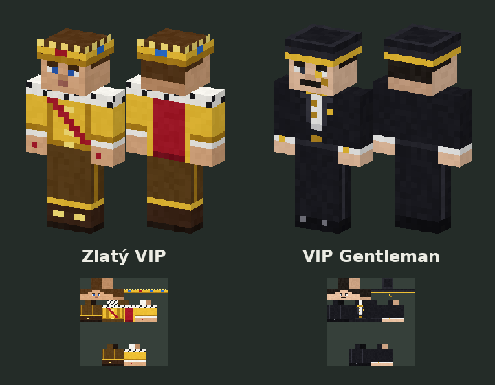

# Skiny hráče: Horník, Rytíř, Robot a 2 VIP

Nové podrobné skiny 64×64 (formát z `app/src/main/cpp/engine/Skin.h`), které
později nahradí jednoduché vestavěné skiny `miner`, `knight`, `robot`, `vip_gold` a `vip_tux` v `Skin.cpp`.
Do hry zatím zapojené nejsou. Teď se dají vyzkoušet přes nahrání vlastního PNG skinu.

| Soubor | Skin | Popis |
|---|---|---|
| `miner.png` | Horník | žlutá helma s čelovkou, reflexní vesta, kožené rukavice, kolenní chrániče, boty s ocelovou špičkou |
| `knight.png` | Rytíř | plátová zbroj, hledí, červený chochol, modrý tabard se zlatým křížem, kroužková zbroj |
| `robot.png` | Robot | kovové pláty, svítící azurové oči, obrazovka na hrudi, baterie na zádech, oranžové klouby |
| `vip_gold.png` | Zlatý VIP | zlatá koruna s rubínem a safíry, hranostajový límec, zlatý kabátec s červenou šerpou, červený plášť na zádech, prsten |
| `vip_tux.png` | VIP Gentleman | cylindr se zlatou stuhou, monokl, knír, frak se saténovými klopami, zlatý motýlek a manžetové knoflíčky, lakýrky |

Všechno je nakreslené pixel po pixelu skriptem `tools/player_skins.py`
(`python3 tools/player_skins.py` znovu vytvoří PNG i náhled).
