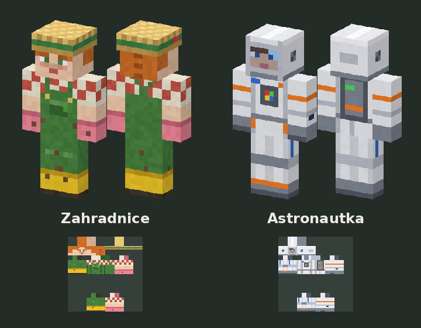
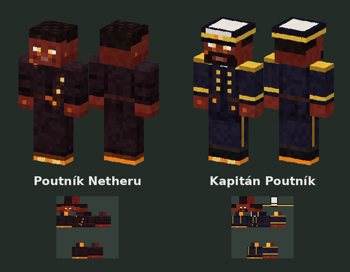

# Skiny hráče: Horník, Rytíř, Robot, Zahradnice, Astronautka, Poutník Netheru a 2 VIP

Nové podrobné skiny 64×64 (formát z `app/src/main/cpp/engine/Skin.h`), které
později nahradí jednoduché vestavěné skiny `miner`, `gardener`, `knight`, `robot`, `astronaut`, `nether_walker`, `vip_gold` a `vip_tux` v `Skin.cpp`.
Do hry zatím zapojené nejsou. Teď se dají vyzkoušet přes nahrání vlastního PNG skinu.

| Soubor | Skin | Popis |
|---|---|---|
| `miner.png` | Horník | žlutá helma s čelovkou, reflexní vesta, kožené rukavice, kolenní chrániče, boty s ocelovou špičkou |
| `knight.png` | Rytíř | plátová zbroj, hledí, červený chochol, modrý tabard se zlatým křížem, kroužková zbroj |
| `robot.png` | Robot | kovové pláty, svítící azurové oči, obrazovka na hrudi, baterie na zádech, oranžové klouby |
| `gardener.png` | Zahradnice | slaměný klobouk se stuhou a kytičkou, zrzavý cop, pihy, kostkovaná košile, lacláče s kapsou, růžové rukavice, žluté holínky |
| `astronaut.png` | Astronautka | bílý skafandr, tónované hledí s obličejem, ovládací panel na hrudi, podpora života na zádech, oranžové pruhy, šedé rukavice a boty |
| `nether_walker.png` | Poutník Netheru | věrně podle původního: stejné barvy, oči, jiskry na hábitu na stejných místech a žhnoucí podrážky; navíc stínování, žhnoucí praskliny, šerpa, límec a manžety |
| `captain_wanderer.png` | Kapitán Poutník | Poutník Netheru jako kapitán: kapitánská čepice se zlatou páskou a žhnoucím odznakem, černý plnovous, dlouhý kabát se zlatými knoflíky a výložky, vysoké boty se žhnoucími podrážkami |
| `vip_gold.png` | Zlatý VIP | zlatá koruna s rubínem a safíry, hranostajový límec, zlatý kabátec s červenou šerpou, červený plášť na zádech, prsten |
| `vip_tux.png` | VIP Gentleman | cylindr se zlatou stuhou, monokl, knír, frak se saténovými klopami, zlatý motýlek a manžetové knoflíčky, lakýrky |

Všechno je nakreslené pixel po pixelu skriptem `tools/player_skins.py`
(`python3 tools/player_skins.py` znovu vytvoří PNG i náhled).
