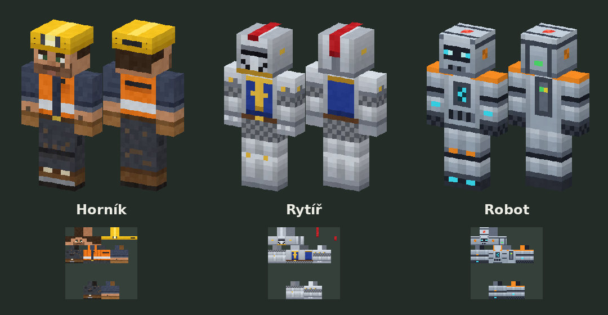

# Skiny hráče: Horník, Rytíř, Robot

Tři nové podrobné skiny 64×64 (formát z `app/src/main/cpp/engine/Skin.h`), které
později nahradí jednoduché vestavěné skiny `miner`, `knight` a `robot` v `Skin.cpp`.
Do hry zatím zapojené nejsou. Teď se dají vyzkoušet přes nahrání vlastního PNG skinu.

| Soubor | Skin | Popis |
|---|---|---|
| `miner.png` | Horník | žlutá helma s čelovkou, reflexní vesta, kožené rukavice, kolenní chrániče, boty s ocelovou špičkou |
| `knight.png` | Rytíř | plátová zbroj, hledí, červený chochol, modrý tabard se zlatým křížem, kroužková zbroj |
| `robot.png` | Robot | kovové pláty, svítící azurové oči, obrazovka na hrudi, baterie na zádech, oranžové klouby |

Všechno je nakreslené pixel po pixelu skriptem `tools/player_skins.py`
(`python3 tools/player_skins.py` znovu vytvoří PNG i náhled).
