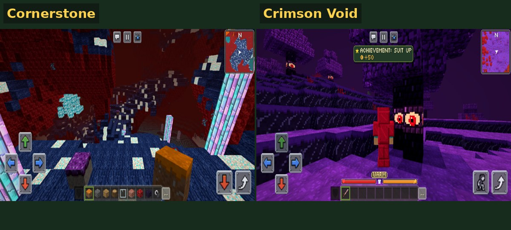
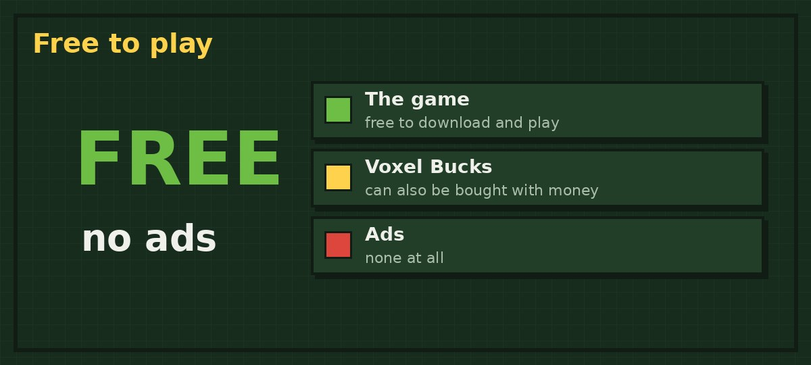
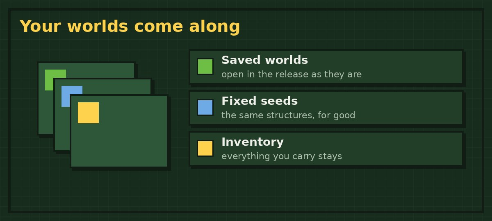
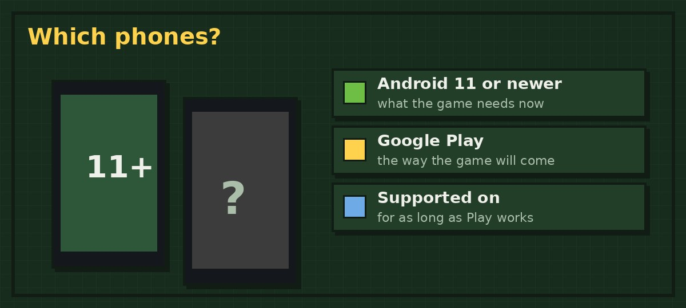
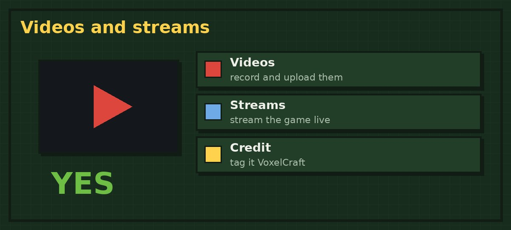
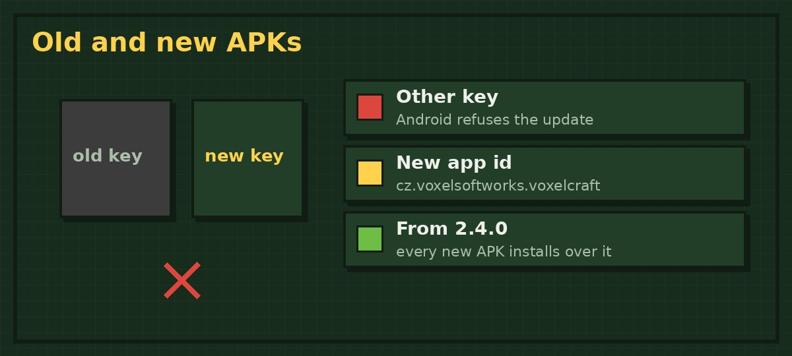

# ❓ VoxelCraft – FAQ

**[🇨🇿 Čeština](#cestina)** · **[🇬🇧 English](#english)**

*Hoppy_Hopsy21 · VoxelSoftworks*

🎬 **[FAQ trailer (3 min)](../trailers/t13_faq.mp4)**

---

<b>🇨🇿 Čeština</b> (klikni pro sbalení / rozbalení)

### 📱 Proč zatím není release na Androidu?

- **Play Console:** vývojářský účet a stránka hry v obchodě Google Play ještě nejsou hotové.
- **Hledání APK:** sestavená APK se dřív špatně hledala. Teď je každá verze ke stažení ve složce
  [`release/`](../release/) tady na GitHubu.

### 🔢 Jak bude release vypadat?

Release zatím není. Hra je stavěná na číslování verzí z Android manifestu (`versionName`):

| Teď | |
|---|---|
| **0.1 – 2.x** | první verze až po Cornerstone a metro |
| **3.x, 4.x, 5.x** | další velké aktualizace |

V budoucnu číslování převedeme na nové, které začne znovu od **1.x.x.x**,
například `1.0.0.0`, `1.0.1.0`, `1.1.0.0`.

### 🪨 Co se bude dít s dimenzemi Cornerstone a Crimson Void před vydáním?

Před vydáním bude potřeba opravit mnoho chyb a bugů:

- 🌱 **Crimson Void:** chybí sazenice karmínového stromu.
- 💎 **Cornerstone:** v písku je rubínová ruda z obyčejného Overworldu.
- ⛏️ **Cornerstone** dostane **vlastní nové rudy**, protože teď používá špatné verze rud z Overworldu.
- 🐾 **Cornerstone** má **málo mobů**, přibudou noví tvorové.
- ✏️ Slovo **„Nether“** se všude úplně nahradí názvem **Cornerstone**.

### 🪙 Co bude s mincemi?

- **„Coins“ se přejmenují na „Voxel Bucks“.** Změní se i jejich tvar v menu: místo mince bude **kostička**.
- V obchodě přibude **nová sekce**, kde si Voxel Bucks můžeš **dokoupit za peníze**.
- **Free spins** (kolo štěstí) a denní odměny zůstanou zdarma jako dosud.
- **VIP** bude fungovat stejně jako kdysi, jen se **speciálním bonusem pro verze 1.x.x.x**.

### 🖥️ Jak bude hra vypadat?

Vzhled menu se během vývoje několikrát měnil. **Současný zelený vzhled už zůstane** a dál se měnit nebude.

### 🔤 Jak to bude s písmem?

- Dřívější alpha a klasické písmo ze starších verzí **0.1 – 1.9.9** zůstane jen tam, kam patří:
  v modpacku **Pre-Alpha Style**, ve starších verzích a ve **VoxelCraft Classic**.
- Všude jinde ho nahradí **nové písmo (Tiny Caps)**.

---

## 🚀 Release

### 📅 Kdy vyjde hra na Google Play?

Během roku **2027**. Možná **1. 1. 2027**, nebo **1. 2. 2027**, kdy bude VoxelCraft slavit **rok od vzniku**.

### 💸 Bude hra zdarma?

- **Ano.** Stáhnout i hrát půjde zdarma.
- **Voxel Bucks** si můžeš i koupit za peníze.
- **Žádné reklamy.**

### 💾 Přenesou se moje světy a předměty do releasu?

**Ano.** Uložené světy, pevné seedy struktur i inventář zůstanou.

### 📱 Na jakých telefonech hra poběží?

- Hra je pro **Android** a bude se podporovat i dál, dokud bude fungovat **Google Play**.
- Hra poběží na **Androidu 5.0 a novějším**.

### 🌐 Bude multiplayer přes internet?

**Ano, bude.** Teď se dá hrát jen přes **LAN** (hráči na stejné Wi-Fi).

### 🍎 Bude verze pro iPhone nebo PC?

Do budoucna je to **v plánu**.

### 🧪 Co je preview a co normální verze?

- **Normální verze** (teď **2.7.0**) je hotová verze. Může ji mít **kdokoli**.
- **Preview** (teď **2.8.0 Preview**) je další update, který se ještě dělá. Má ji **jen developer**.
- Obě jsou samostatné aplikace, takže můžou být v telefonu **vedle sebe**.

### 🐞 Jak nahlásit chybu?

**Ve hře:** Nastavení → **Nahlásit chybu**. Napíšeš krátký název a popis a hra otevře GitHub s vyplněným hlášením (verze hry, svět, telefon). Stačí ho odeslat.

Nebo založ nový **Issue** přímo tady na GitHubu ([Issues](../../../issues)) a napiš:

1. **Co se stalo** a co jsi čekal(a).
2. **Jak to zopakovat**, krok po kroku.
3. **Verzi hry** a **telefon** (model a verzi Androidu).
4. Pokud můžeš, přidej **screenshot** nebo video.

### 🎥 Můžu točit videa a streamovat VoxelCraft?

**Ano!** Videa i streamy jsou vítané.

### 🔑 Proč se staré APK nedají nainstalovat přes nové?

- Starší verze byly podepsané **jiným klíčem**. Android update s jiným klíčem nepovolí.
- Od verze **2.4.0** má hra **nové ID aplikace** (`cz.voxelsoftworks.voxelcraft`) a **trvalý klíč**.
- Každé nové APK se od 2.4.0 nainstaluje přes předchozí, bez odinstalování.

## 🛠️ Změny ve 2.7.0

### ⛓️ Proč bylo odstraněno železo?

- Železo se od 2.7.0 **na nic nevyrábí**. Ve všech receptech je místo něj **ocel**.
- Železný ingot dáš s uhlím do výroby a vznikne **ocelová směs**. V peci z ní je ocel.
- Železné nástroje a brnění se už nevyrábí. Úplně zmizí ve **3.0.0**. VoxelCraft je vlastní hra a nechce kopírovat cizí sady nástrojů.
- Železo mělo hezčí barvu, a tak ji dostala **ocelová sada**: krumpáč, sekera, lopata, meč i brnění.

### 🎨 Proč většina věcí dostala nový vzhled?

- Hra roste a staré obrázky z prvních verzí vedle nových věcí působily chudě.
- Ve 2.7.0 se překreslila **vajíčka** (každý tvor má svůj vzor), **maso**, **šíp**, **provázek**, **ingoty**, **hardiová ruda**, **bronzové dveře** a **zarážedlo na koleji**.
- Staré textury jsou schované v `archived/ui_2.6.0/` a hrají dál ve verzi 2.6.0, třeba na natáčení.

### 🖌️ Proč byly textury dřív tak jednoduché?

- VoxelCraft nepoužívá žádné obrázky od Mojangu. Všechny textury **kreslí přímo kód hry** pixel po pixelu.
- V prvních verzích šlo hlavně o to, aby věci fungovaly. Obrázky byly rychlé, s pár barvami a tečkami.
- Teď je čas je vyladit: stínování, obrys, odlesk a vzor, který je hned poznat.

### 🐾 Jaké chyby měli tvorové a kaktusy?

- Tvorové brali **napadaný sníh** jako celý blok a vylézali na něj. Teď jím projdou.
- V **lávě** dřív poskakovali, protože je láva odhazovala jako úder. Teď do ní zapadnou a pálí je. Žhavá můra, popelavý lišák a prasák lávu snesou.
- **Kaktusy** jednu dobu nepíchaly. Opraveno ve 2.5.0.
- Tyhle chyby se rády vrací. Když uvidíš tvora levitovat, skákat v lávě nebo kaktus, který nepíchá, **nahlaš to přes Nahlásit chybu** v nastavení (otevře GitHub Issues).

---

<b>🇬🇧 English</b> (click to open / close)

### 📱 Why is there no Android release yet?

- **Play Console:** the developer account and the game's Google Play listing are not finished yet.
- **Finding the APKs:** the builds used to be hard to find. Now every version can be downloaded
  from the [`release/`](../release/) folder here on GitHub.

### 🔢 What will the release look like?

There is no release yet. The game uses the version numbers of its Android manifest (`versionName`):

| Now | |
|---|---|
| **0.1 – 2.x** | from the first versions up to the Cornerstone and the subway |
| **3.x, 4.x, 5.x** | the next big updates |

Later the numbering will start again from **1.x.x.x**,
for example `1.0.0.0`, `1.0.1.0`, `1.1.0.0`.

### 🪨 What happens to the Cornerstone and the Crimson Void before the release?

Many mistakes and bugs need fixing first:

- 🌱 **Crimson Void:** the crimson tree has no sapling yet.
- 💎 **Cornerstone:** its sand has the ruby ore of the normal Overworld.
- ⛏️ **The Cornerstone** gets **its own new ores**, because it uses the wrong Overworld versions now.
- 🐾 **The Cornerstone** has **too few mobs**; new creatures will come.
- ✏️ The word **"Nether"** will be replaced by **Cornerstone** everywhere.

### 🪙 What happens to the coins?

- **"Coins" will be renamed "Voxel Bucks"**, and their look in the menus changes from a coin to a **little cube**.
- The store gets a **new section** where Voxel Bucks can be **bought with real money**.
- **Free spins** (the wheel) and daily rewards stay free, as now.
- **VIP** works as it used to, with a **special bonus for versions 1.x.x.x**.

### 🖥️ How will the game look?

The look of the menus changed a few times during development. **The current green look stays** and will not change again.

### 🔤 What about the font?

- The earlier alpha and classic font of versions **0.1 – 1.9.9** stays only where it belongs:
  in the **Pre-Alpha Style** modpack, in the older versions and in **VoxelCraft Classic**.
- Everywhere else the **new font (Tiny Caps)** replaces it.

---

## 🚀 Release

### 📅 When does the game come to Google Play?

During **2027**. Maybe on **1 January 2027**, or on **1 February 2027**, when VoxelCraft turns **one year old**.

### 💸 Will the game be free?

- **Yes.** Downloading and playing are free.
- **Voxel Bucks** can also be bought with money.
- **No ads.**

### 💾 Will my worlds and items carry over to the release?

**Yes.** Saved worlds, the fixed structure seeds and your inventory all stay.

### 📱 Which phones will the game run on?

- The game is for **Android** and stays supported for as long as **Google Play** works.
- The game runs on **Android 5.0 and newer**.

### 🌐 Will there be online multiplayer?

**Yes.** For now only **LAN** play works (players on the same Wi-Fi).

### 🍎 Will there be an iPhone or PC version?

It is **planned** for the future.

### 🧪 What is the preview and what is the normal version?

- The **normal version** (now **2.7.0**) is the finished one. **Anyone** can have it.
- The **preview** (now **2.8.0 Preview**) is the next update, still being made. **Only the developer** has it.
- They are separate apps, so both can be installed **side by side**.

### 🐞 How do I report a bug?

**In the game:** Settings → **Report a bug**. Write a short title and a description, and the game opens GitHub with the report filled in (game version, world, phone). Just submit it.

Or open a new **issue** right here on GitHub ([Issues](../../../issues)) and write:

1. **What happened**, and what you expected.
2. **How to make it happen again**, step by step.
3. The **game version** and your **phone** (model and Android version).
4. A **screenshot** or video, if you can.

### 🎥 Can I make videos and stream VoxelCraft?

**Yes!** Videos and streams are welcome.

### 🔑 Why can't old APKs be installed over new ones?

- Older versions were signed with **another key**, and Android refuses an update signed with a different key.
- Since **2.4.0** the game has a **new app id** (`cz.voxelsoftworks.voxelcraft`) and a **lasting key**.
- From 2.4.0 on, every new APK installs over the previous one without uninstalling.

## 🛠️ Changes in 2.7.0

### ⛓️ Why was iron removed?

- From 2.7.0 iron is **not made into anything**; every recipe takes **steel** instead.
- An iron ingot and coal make a **steel mix**, which the furnace turns into steel.
- Iron tools and armour are no longer made and go completely in **3.0.0**: VoxelCraft is its own game and does not copy other games' tool sets.
- Iron had the nicer colour, so the **steel set** (pickaxe, axe, shovel, sword, armour) took it.

### 🎨 Why did most things get a new look?

- The game grew and the pictures of the first versions looked poor next to the new things.
- 2.7.0 redraws the **spawn eggs** (a pattern per creature), **meat**, **arrow**, **string**, **ingots**, **hardium ore**, **bronze door** and the **buffer stop**.
- The old textures are kept in `archived/ui_2.6.0/` and still play in 2.6.0, for filming.

### 🖌️ Why were the textures so simple before?

- VoxelCraft uses no Mojang pictures: **the game's code draws every texture** pixel by pixel.
- The first versions were about making things work; the pictures were quick, a few colours and dots.
- Now is the time to polish them: shading, an outline, a shine and a pattern you recognise at once.

### 🐾 What problems did the creatures and cacti have?

- Creatures took **fallen snow** for a whole block and climbed onto it; now they walk through it.
- In **lava** they bounced, because lava pushed them like a hit; now they sink and burn. The ember moth, ash fox and hogman don't mind lava.
- **Cacti** did not hurt for a while; fixed in 2.5.0.
- These bugs like to come back. If you see a creature float, bounce in lava or a cactus that doesn't hurt, **report it with Report a bug** in the settings (it opens GitHub Issues).

---

[⬅️ README](../README.md)

