

# ❓ VoxelCraft – FAQ

**[🇨🇿 Čeština](#cestina)** · **[🇬🇧 English](#english)**

*Hoppy_Hopsy21 · VoxelSoftworks*

🎬 **[FAQ trailer (3 min)](../trailers/t13_faq.mp4)**

---

<b>🇨🇿 Čeština</b> (klikni pro sbalení / rozbalení)

### 📱 Proč zatím není release na Androidu?

- **Play Console:** vývojářský účet a stránka hry v obchodě Google Play ještě nejsou hotové.
- **Hledání APK:** sestavená APK se dřív špatně hledala. Teď je každá verze ke stažení ve složce
  [`release/`](../release/) tady na GitHubu.

### 🔢 Jak bude release vypadat?

Release zatím není. Hra je stavěná na číslování verzí z Android manifestu (`versionName`):

| Teď | |
|---|---|
| **0.1 – 2.x** | první verze až po Cornerstone a metro |
| **3.x, 4.x, 5.x** | další velké aktualizace |

V budoucnu číslování převedeme na nové, které začne znovu od **1.x.x.x**,
například `1.0.0.0`, `1.0.1.0`, `1.1.0.0`.

### 🪨 Co se bude dít s dimenzemi Cornerstone a Crimson Void před vydáním?

Před vydáním bude potřeba opravit mnoho chyb a bugů:

- 🌱 **Crimson Void:** chybí sazenice karmínového stromu.
- 💎 **Cornerstone:** v písku je rubínová ruda z obyčejného Overworldu.
- ⛏️ **Cornerstone** dostane **vlastní nové rudy**, protože teď používá špatné verze rud z Overworldu.
- 🐾 **Cornerstone** má **málo mobů**, přibudou noví tvorové.
- ✏️ Slovo **„Nether“** se všude úplně nahradí názvem **Cornerstone**.

### 🪙 Co bude s mincemi?

- **„Coins“ se přejmenují na „Voxel Bucks“.** Změní se i jejich tvar v menu: místo mince bude **kostička**.
- V obchodě přibude **nová sekce**, kde si Voxel Bucks můžeš **dokoupit za peníze**.
- **Free spins** (kolo štěstí) a denní odměny zůstanou zdarma jako dosud.
- **VIP** bude fungovat stejně jako kdysi, jen se **speciálním bonusem pro verze 1.x.x.x**.

### 🖥️ Jak bude hra vypadat?

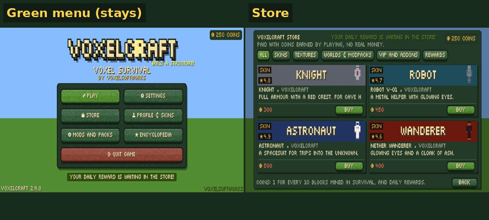

Vzhled menu se během vývoje několikrát měnil. **Současný zelený vzhled už zůstane** a dál se měnit nebude.

### 🔤 Jak to bude s písmem?

- Dřívější alpha a klasické písmo ze starších verzí **0.1 – 1.9.9** zůstane jen tam, kam patří:
  v modpacku **Pre-Alpha Style**, ve starších verzích a ve **VoxelCraft Classic**.
- Všude jinde ho nahradí **nové písmo (Tiny Caps)**.

---

## 🚀 Release

### 📅 Kdy vyjde hra na Google Play?

Během roku **2027**. Možná **1. 1. 2027**, nebo **1. 2. 2027**, kdy bude VoxelCraft slavit **rok od vzniku**.

### 💸 Bude hra zdarma?

- **Ano.** Stáhnout i hrát půjde zdarma.
- **Voxel Bucks** si můžeš i koupit za peníze.
- **Žádné reklamy.**

### 💾 Přenesou se moje světy a předměty do releasu?

**Ano.** Uložené světy, pevné seedy struktur i inventář zůstanou.

### 📱 Na jakých telefonech hra poběží?

- Hra je pro **Android** a bude se podporovat i dál, dokud bude fungovat **Google Play**.
- Hra poběží na **Androidu 5.0 a novějším**.

### 🌐 Bude multiplayer přes internet?

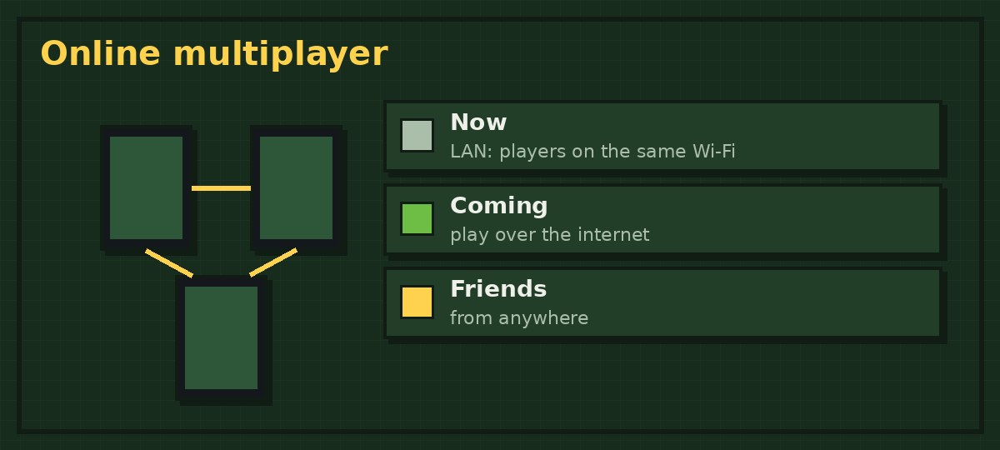

**Ano, bude.** Teď se dá hrát jen přes **LAN** (hráči na stejné Wi-Fi).

### 🍎 Bude verze pro iPhone nebo PC?

Do budoucna je to **v plánu**.

### 🧪 Co je preview a co normální verze?

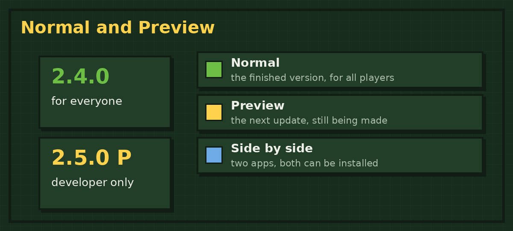

- **Normální verze** (teď **2.7.0**) je hotová verze. Může ji mít **kdokoli**.
- **Preview** (teď **2.8.0 Preview**) je další update, který se ještě dělá. Má ji **jen developer**.
- Obě jsou samostatné aplikace, takže můžou být v telefonu **vedle sebe**.

### 🐞 Jak nahlásit chybu?

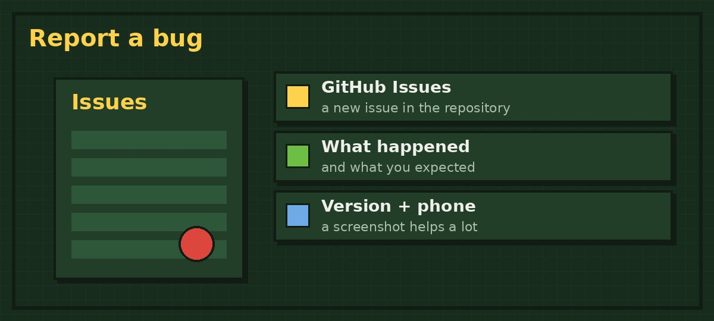

**Ve hře:** Nastavení → **Nahlásit chybu**. Napíšeš krátký název a popis a hra otevře GitHub s vyplněným hlášením (verze hry, svět, telefon). Stačí ho odeslat.

Nebo založ nový **Issue** přímo tady na GitHubu ([Issues](../../../issues)) a napiš:

1. **Co se stalo** a co jsi čekal(a).
2. **Jak to zopakovat**, krok po kroku.
3. **Verzi hry** a **telefon** (model a verzi Androidu).
4. Pokud můžeš, přidej **screenshot** nebo video.

### 🎥 Můžu točit videa a streamovat VoxelCraft?

**Ano!** Videa i streamy jsou vítané.

### 🔑 Proč se staré APK nedají nainstalovat přes nové?

- Starší verze byly podepsané **jiným klíčem**. Android update s jiným klíčem nepovolí.
- Od verze **2.4.0** má hra **nové ID aplikace** (`cz.voxelsoftworks.voxelcraft`) a **trvalý klíč**.
- Každé nové APK se od 2.4.0 nainstaluje přes předchozí, bez odinstalování.

## 🎮 Hra, výkon a soubory

### 🧱 Co se dá ve VoxelCraftu dělat?

- **Stavět a vyrábět**: stovky bloků, nástroje, brnění, batohy, peněženka, vlaky, koleje i metro.
- **Prozkoumávat**: čtyři dimenze, vesnice, metro, ztracené město, vraky, chrámy, doly a tábory.
- **Bojovat a starat se**: tvorové, bossové Crimson Man a Sky Guardian, farma, zvířata, ochočený lišák.
- **Tvořit a hrát s ostatními**: kreativ, doplňky a Tvůrce, struktury, LAN multiplayer, vlastní skiny.

### 🦊 Jak ochočím lišáka a co umí?

- Klepni na lišáka **syrovým masem** (vepřové, hovězí, skopové nebo kuřecí). Je tvůj a dostane červený obojek.
- Chodí za tebou a **kouše příšery**. Klepnutím v **plížení** si sedne a čeká, dalším klepnutím jde zase s tebou.
- Klepnutím **barvivem** obojek přebarvíš (16 barev).
- Ochočit jde i **popelavý lišák** z Cornerstone.

### 🗺️ Kde najdu metro, ztracené město a další stavby?

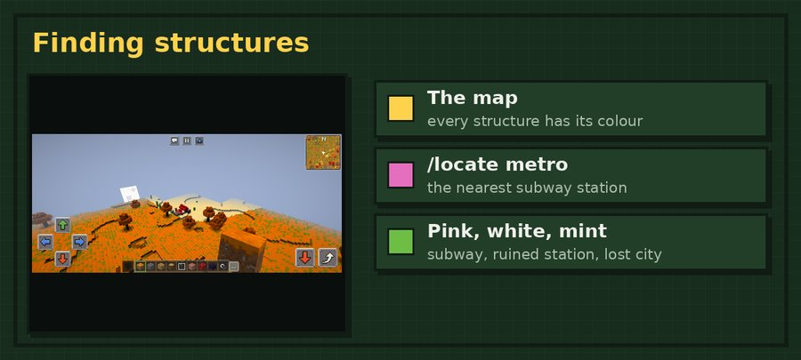

- Na **mapě** má každá stavba svůj domeček a barvu: metro **růžové**, rozpadlé nádraží **bílé**, ztracené město **mátové**, vesnice **zelené**, vraky vlaků **červenohnědé**.
- Metro se na mapě ukáže, když jsi do **300 bloků** od něj.
- Příkaz `/locate metro` (a `/locate city`, `/locate station`…) ukáže nejbližší místo.

### 🟫 Jak funguje rezavění oceli a bronzu?

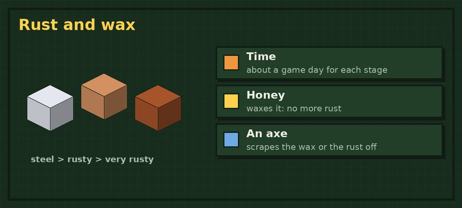

- Ocelové a bronzové bloky časem **zrezaví**, zhruba o stupeň za herní den.
- **Med** blok navoskuje a ten už nikdy nezrezaví.
- **Sekera** oškrábe vosk, nebo rez o jeden stupeň.

### 🌌 Jak se dostanu do všech čtyř dimenzí?

- **Cornerstone**: postav rám z **obsidiánu** a zapal ho **křesadlem**.
- **Crimson Void**: v Cornerstone postav rám z **void stone** a zapal ho **void křesadlem**. Čeká tam boss **Crimson Man**.
- **Celestial Reach**: polož **12 hlav Karmínového muže** na nebeský rám. Čeká tam **Sky Guardian**.

### 🐢 Hra se mi seká, co mám dělat?

- **Nastavení > Grafika > Výkon zařízení**: **Plný**, **Smoother+** nebo **Slabé**. Hra ho nastaví sama podle grafického čipu a paměti.
- **Slabé** má lehkou grafiku, 30 FPS a kratší dohled. Hodí se třeba pro Teclast P30T nebo Galaxy A14.
- **Smoother+** zkrátí dohled a nechá shadery, dokud je telefon stíhá. Hodí se pro Redmi Note 13 5G.
- **Úspora baterie** se zapne sama při 35 % a méně.

### ✨ Proč se mi vypnuly shadery?

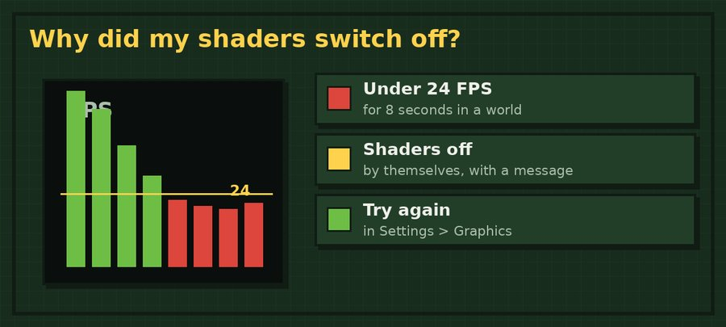

- Když hra drží **8 sekund pod 24 FPS**, shadery se **samy vypnou** a ukáže se zpráva.
- V **Nastavení > Grafika** je zapneš znovu tlačítkem **Zkusit znovu**, nebo přepnutím Grafiky na Vylepšenou.

### 💾 Jak zálohuju a přenesu svět?

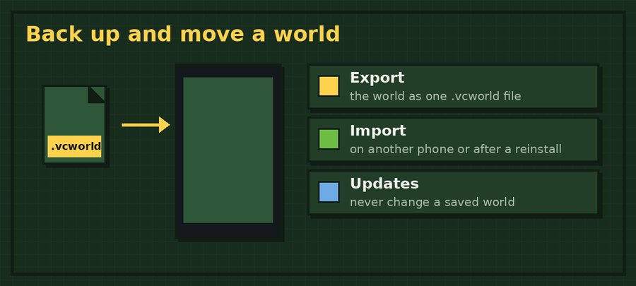

- V seznamu světů **Upravit > Exportovat svět** uloží celý svět do jednoho souboru **.vcworld**.
- Na jiném telefonu nebo po přeinstalaci ho přidáš přes **Import**.
- **Aktualizace hry uložené světy nemění.** Nové stavby a rudy se objeví jen v nových světech.

### ⛏️ Můžu si otevřít svět z Minecraftu?

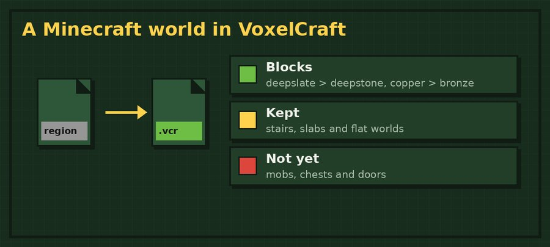

- Ano, bloky se převedou na naše: deepslate na hlubinný kámen, redstone na powerstone, měď na bronz, quartz na bílý beton.
- Schody a desky si drží směr a ploché světy zůstanou ploché.
- Tvorové, obsah truhel a dveře se **zatím nepřenesou**.

### 🧩 Proč mód z Bedrocku nebo Javy nefunguje úplně?

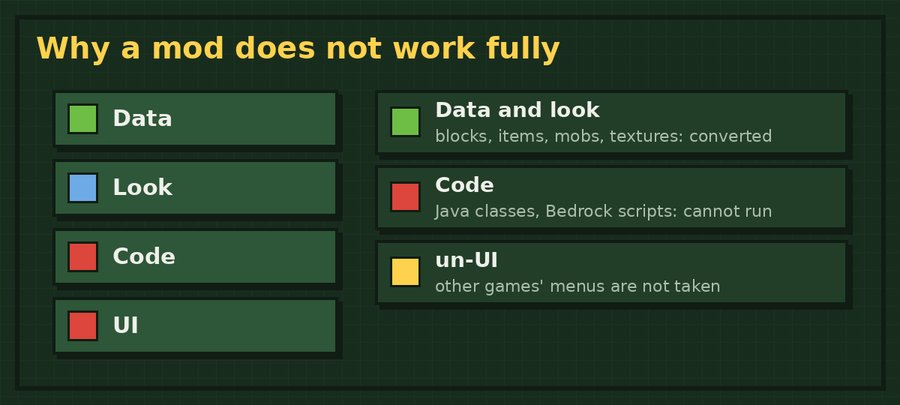

- Převést jde **data a vzhled**: bloky, předměty, tvory, recepty, textury a atlasy.
- **Kód** (třídy Javy, skripty Bedrocku) VoxelCraft spustit neumí, a tak se přeskočí.
- **UI** cizích módů se nepřebírá. Takový doplněk má štítek **un-UI**.
- Co přesně se stalo, ukáže tlačítko **Chyby** ve Správci doplňků.

### 🖼️ Jak udělám vlastní texture pack?

- Nakresli obrázky **PNG 16×16**, jeden na blok nebo předmět. Dej je do složek `blocks/` a `items/`, nebo udělej jeden starý `terrain.png`.
- Zabal je do **.zip**, **.mcpack** nebo **.vcpack**.
- Nahraješ je v **Nastavení > Globální zdroje** nebo tlačítkem **+ Importovat** ve Správci doplňků. Co chybí, zůstane v našem vzhledu.

### 🛡️ Je modování bezpečné?

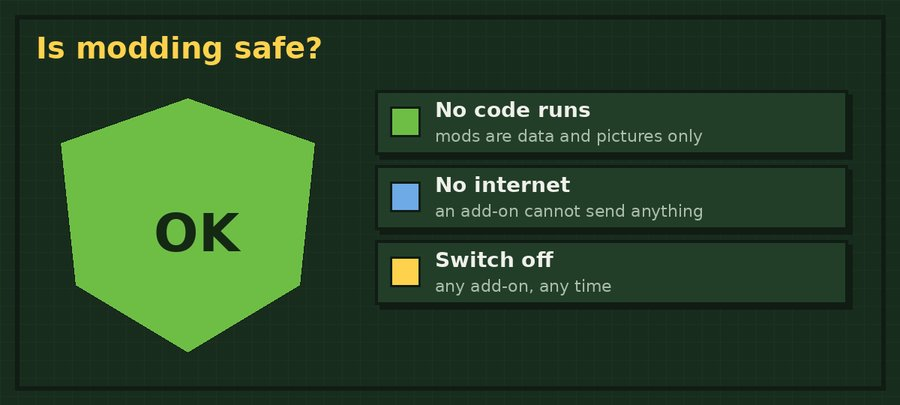

- Doplňky VoxelCraftu jsou **jen data a obrázky**. Žádný kód se nespouští.
- Doplněk nemůže nic posílat na internet.
- Každý doplněk jde kdykoli **vypnout** nebo **smazat**.

### 📂 Co jsou .vcworld, .vcr, .vct, .vcstructure, .vcpack a .vcaddon?

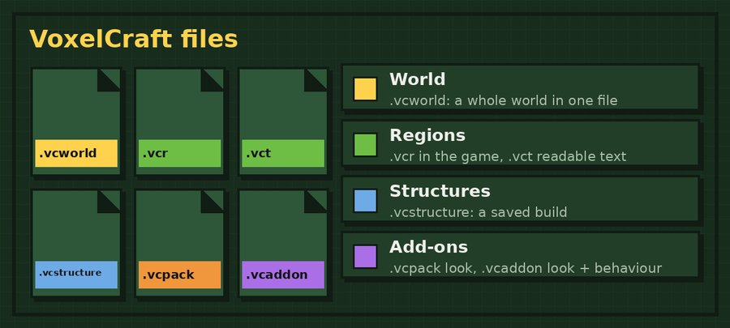

| Soubor | Co to je | Jak to funguje |
|---|---|---|
| **.vcworld** | celý svět v jednom souboru | zip se světem: `level.dat`, tvorové, truhly, regiony; vznikne exportem, nahraje se importem |
| **.vcr** | region světa (32 × 32 chunků) | binární a komprimovaný; tak hra ukládá svět v telefonu |
| **.vct** | stejný region jako čitelný text | ve .vcworld místo .vcr; jde otevřít a přečíst, při importu se převede zpět na .vcr |
| **.vcstructure** | uložená stavba | ukládá ji **structure block**, jde ji vložit do jiného světa (a umíme i `.mcstructure`) |
| **.vcpack** | doplněk jen se **vzhledem** (Resource Voxel) | zip s `manifest.json` a texturami, atlasy, modely nebo shadery |
| **.vcaddon** | doplněk se **vzhledem i chováním** | zip s `manifest.json`, `content.json` (bloky, předměty, tvorové), recepty a texturami |

## 🛠️ Vývoj

### 🔁 Jak vzniká nová verze?

1. **Nápady**: co se má změnit, se nejdřív nakreslí jako návrh a schválí.
2. **Preview buildy**: každý build se otestuje, nahraje na GitHub a dostane číslo (build 1, 2, 3…).
3. **Vydání**: hotové APK jde do `release/` pro všechny a preview se posune na další verzi.
4. **Archiv**: stará hudba, UI a textury zůstávají v `archived/` a staré verze v `release/`.

### 🚫 Proč hra nepoužívá nic od Mojangu?

- VoxelCraft má **vlastní engine** v C++ a OpenGL ES.
- Každou texturu **kreslí kód hry** pixel po pixelu a hudba je naše vlastní.
- Je to neoficiální fanouškovský projekt, který nechce nic kopírovat.

### 🔮 Co bude ve 3.0.0?

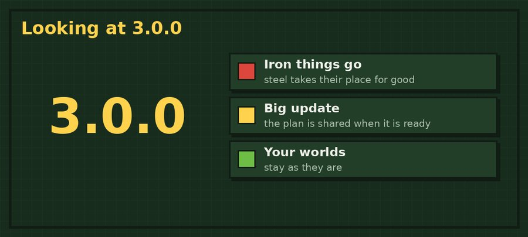

- **Železné věci zmizí** a ocel je nahradí natrvalo.
- Plán velkého updatu zveřejníme, až bude hotový.
- Tvoje světy zůstanou, jak jsou.

## 🛠️ Změny ve 2.7.0

### ⛓️ Proč bylo odstraněno železo?

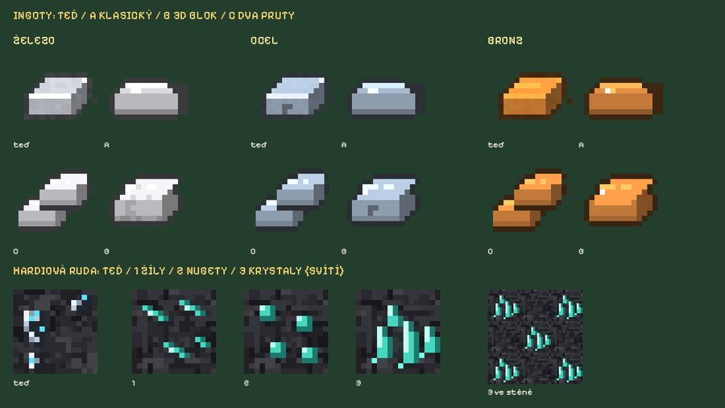

- Železo se od 2.7.0 **na nic nevyrábí**. Ve všech receptech je místo něj **ocel**.
- Železný ingot dáš s uhlím do výroby a vznikne **ocelová směs**. V peci z ní je ocel.
- Železné nástroje a brnění se už nevyrábí. Úplně zmizí ve **3.0.0**. VoxelCraft je vlastní hra a nechce kopírovat cizí sady nástrojů.
- Železo mělo hezčí barvu, a tak ji dostala **ocelová sada**: krumpáč, sekera, lopata, meč i brnění.

### 🎨 Proč většina věcí dostala nový vzhled?

- Hra roste a staré obrázky z prvních verzí vedle nových věcí působily chudě.
- Ve 2.7.0 se překreslila **vajíčka** (každý tvor má svůj vzor), **maso**, **šíp**, **provázek**, **ingoty**, **hardiová ruda**, **bronzové dveře** a **zarážedlo na koleji**.
- Staré textury jsou schované v `archived/ui_2.6.0/` a hrají dál ve verzi 2.6.0, třeba na natáčení.

### 🖌️ Proč byly textury dřív tak jednoduché?

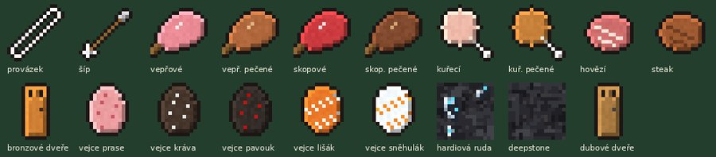

- VoxelCraft nepoužívá žádné obrázky od Mojangu. Všechny textury **kreslí přímo kód hry** pixel po pixelu.
- V prvních verzích šlo hlavně o to, aby věci fungovaly. Obrázky byly rychlé, s pár barvami a tečkami.
- Teď je čas je vyladit: stínování, obrys, odlesk a vzor, který je hned poznat.

### 🎒 Jak fungují batohy?

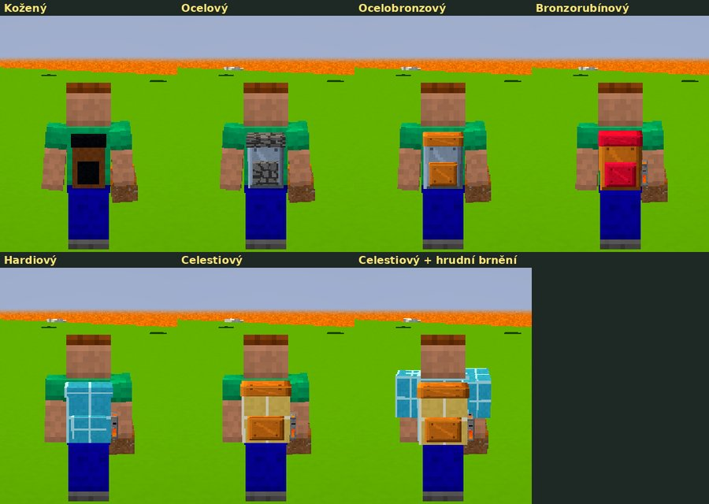

- Šest úrovní: **kůže, ocel, ocelobronz, bronzorubín, hardium, celestium**. Od 9 do 54 míst.
- Uvnitř je **výroba** (2×2, od ocelobronzu 3×3) a od bronzorubínu i **pec**. Tlačítka jsou v řádku pod místy batohu.
- Batoh polož do slotu pro hrudní brnění: přesune se **na záda** a brnění můžeš nasadit přes něj. Ve hře ho otevřeš tlačítkem nad „…“.
- Vylepšení: batoh doprostřed a kolem 4× kov další úrovně. **Obsah zůstane.**

### 🧩 Jak funguje nové modování?

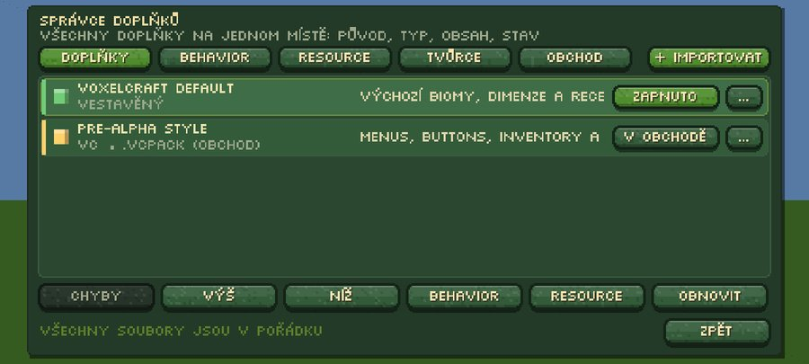

- Menu > **Módy a balíčky** otevře **Správce doplňků** se záložkami **Doplňky, Behavior, Resource, Tvůrce, Obchod**.
- Barevný proužek ukazuje původ: zelená VC, oranžová Java, modrá Bedrock, zlatá Obchod, červená chyba.
- **+ Importovat** vezme `.vcaddon`, `.vcpack`, `.mcaddon`, `.mcpack`, `.jar` i `.zip`.
- **Behavior Voxel** je chování (bloky, předměty, moby, recepty, svět), **Resource Voxel** je vzhled (textury, atlasy, modely, shadery).

### 🔄 Co se stane s módem z Bedrocku nebo Javy?

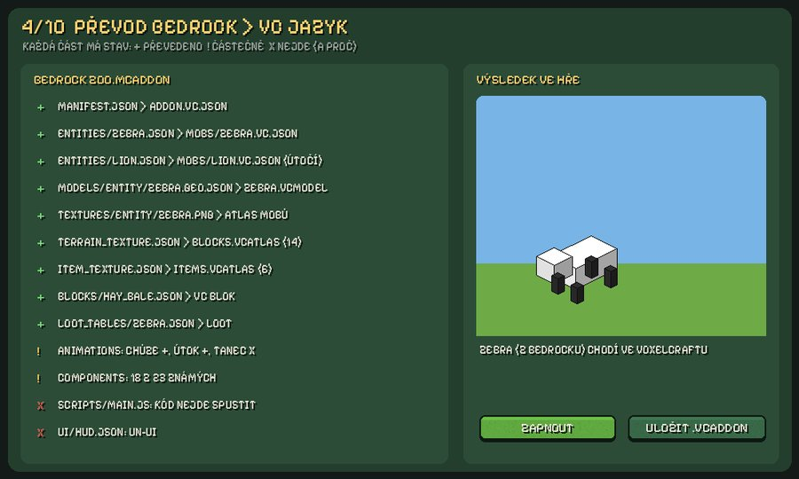

- Hra ho **převede do VC jazyka**: bloky, předměty, moby, textury, atlasy `terrain_texture.json` a `item_texture.json`, z `geo.json` pozná tělo tvora.
- Ke každému souboru napíše, co se stalo: **+ převedeno, ! částečně, x nejde**. Najdeš to pod tlačítkem **Chyby**. Nic už neselže potichu.
- **Kód** (Java třídy, Bedrock skripty) spustit nejde a **UI** cizích módů se nepřebírá. Takový doplněk má štítek **un-UI**.

### 🖌️ Jak si udělám vlastní blok nebo moba?

- Záložka **Tvůrce**: přepni **Blok** nebo **Mob**, napiš název, nastav tvrdost a světlo (blok) nebo tělo a životy (mob).
- Namaluj texturu 16×16 **štětcem** nebo **výplní** z 12 barev a stiskni **Uložit do .vcaddon**.
- Všechno se uloží do doplňku **Moje tvorba** a hned je ve hře.

### 🐾 Jaké chyby měli tvorové a kaktusy?

- Tvorové brali **napadaný sníh** jako celý blok a vylézali na něj. Teď jím projdou.
- V **lávě** dřív poskakovali, protože je láva odhazovala jako úder. Teď do ní zapadnou a pálí je. Žhavá můra, popelavý lišák a prasák lávu snesou.
- **Kaktusy** jednu dobu nepíchaly. Opraveno ve 2.5.0.
- Tyhle chyby se rády vrací. Když uvidíš tvora levitovat, skákat v lávě nebo kaktus, který nepíchá, **nahlaš to přes Nahlásit chybu** v nastavení (otevře GitHub Issues).

---

<b>🇬🇧 English</b> (click to open / close)

### 📱 Why is there no Android release yet?

- **Play Console:** the developer account and the game's Google Play listing are not finished yet.
- **Finding the APKs:** the builds used to be hard to find. Now every version can be downloaded
  from the [`release/`](../release/) folder here on GitHub.

### 🔢 What will the release look like?

There is no release yet. The game uses the version numbers of its Android manifest (`versionName`):

| Now | |
|---|---|
| **0.1 – 2.x** | from the first versions up to the Cornerstone and the subway |
| **3.x, 4.x, 5.x** | the next big updates |

Later the numbering will start again from **1.x.x.x**,
for example `1.0.0.0`, `1.0.1.0`, `1.1.0.0`.

### 🪨 What happens to the Cornerstone and the Crimson Void before the release?

Many mistakes and bugs need fixing first:

- 🌱 **Crimson Void:** the crimson tree has no sapling yet.
- 💎 **Cornerstone:** its sand has the ruby ore of the normal Overworld.
- ⛏️ **The Cornerstone** gets **its own new ores**, because it uses the wrong Overworld versions now.
- 🐾 **The Cornerstone** has **too few mobs**; new creatures will come.
- ✏️ The word **"Nether"** will be replaced by **Cornerstone** everywhere.

### 🪙 What happens to the coins?

- **"Coins" will be renamed "Voxel Bucks"**, and their look in the menus changes from a coin to a **little cube**.
- The store gets a **new section** where Voxel Bucks can be **bought with real money**.
- **Free spins** (the wheel) and daily rewards stay free, as now.
- **VIP** works as it used to, with a **special bonus for versions 1.x.x.x**.

### 🖥️ How will the game look?

The look of the menus changed a few times during development. **The current green look stays** and will not change again.

### 🔤 What about the font?

- The earlier alpha and classic font of versions **0.1 – 1.9.9** stays only where it belongs:
  in the **Pre-Alpha Style** modpack, in the older versions and in **VoxelCraft Classic**.
- Everywhere else the **new font (Tiny Caps)** replaces it.

---

## 🚀 Release

### 📅 When does the game come to Google Play?

During **2027**. Maybe on **1 January 2027**, or on **1 February 2027**, when VoxelCraft turns **one year old**.

### 💸 Will the game be free?

- **Yes.** Downloading and playing are free.
- **Voxel Bucks** can also be bought with money.
- **No ads.**

### 💾 Will my worlds and items carry over to the release?

**Yes.** Saved worlds, the fixed structure seeds and your inventory all stay.

### 📱 Which phones will the game run on?

- The game is for **Android** and stays supported for as long as **Google Play** works.
- The game runs on **Android 5.0 and newer**.

### 🌐 Will there be online multiplayer?

**Yes.** For now only **LAN** play works (players on the same Wi-Fi).

### 🍎 Will there be an iPhone or PC version?

It is **planned** for the future.

### 🧪 What is the preview and what is the normal version?

- The **normal version** (now **2.7.0**) is the finished one. **Anyone** can have it.
- The **preview** (now **2.8.0 Preview**) is the next update, still being made. **Only the developer** has it.
- They are separate apps, so both can be installed **side by side**.

### 🐞 How do I report a bug?

**In the game:** Settings → **Report a bug**. Write a short title and a description, and the game opens GitHub with the report filled in (game version, world, phone). Just submit it.

Or open a new **issue** right here on GitHub ([Issues](../../../issues)) and write:

1. **What happened**, and what you expected.
2. **How to make it happen again**, step by step.
3. The **game version** and your **phone** (model and Android version).
4. A **screenshot** or video, if you can.

### 🎥 Can I make videos and stream VoxelCraft?

**Yes!** Videos and streams are welcome.

### 🔑 Why can't old APKs be installed over new ones?

- Older versions were signed with **another key**, and Android refuses an update signed with a different key.
- Since **2.4.0** the game has a **new app id** (`cz.voxelsoftworks.voxelcraft`) and a **lasting key**.
- From 2.4.0 on, every new APK installs over the previous one without uninstalling.

## 🎮 The game, performance and files

### 🧱 What can you do in VoxelCraft?

- **Build and craft**: hundreds of blocks, tools, armour, backpacks, a wallet, trains, rails and the subway.
- **Explore**: four dimensions, villages, the subway, the lost city, wrecks, temples, mines and camps.
- **Fight and look after**: creatures, the bosses Crimson Man and Sky Guardian, a farm, animals, a tamed fox.
- **Create and play together**: creative mode, add-ons and the Creator, structures, LAN multiplayer, your own skins.

### 🦊 How do I tame a fox and what does it do?

- Tap a fox with **raw meat** (pork, beef, mutton or chicken): it is yours and gets a red collar.
- It follows you and **bites monsters**; tap it while **sneaking** to make it sit and wait, again to take it along.
- Tap it with a **dye** to recolour the collar (16 colours). The Cornerstone's **ash fox** can be tamed too.

### 🗺️ Where do I find the subway, the lost city and other structures?

- On the **map** every structure has its house and colour: subway **pink**, ruined station **white**, lost city **mint**, villages **green**, train wrecks **red-brown**.
- The subway shows on the map within **300 blocks**.
- `/locate metro` (and `/locate city`, `/locate station`…) shows the nearest one.

### 🟫 How do steel and bronze rust?

- Steel and bronze blocks **rust** over time, about a stage per game day.
- **Honey** waxes a block: it never rusts again.
- An **axe** scrapes the wax off, or the rust by one stage.

### 🌌 How do I get into all four dimensions?

- **Cornerstone**: build an **obsidian** frame and light it with **flint and steel**.
- **Crimson Void**: in the Cornerstone build a **void stone** frame and light it with **void flint and steel**; the boss **Crimson Man** waits there.
- **Celestial Reach**: put **12 Crimson Man heads** on the celestial frame; the **Sky Guardian** waits there.

### 🐢 The game stutters, what do I do?

- **Settings > Graphics > Device power**: **Full**, **Smoother+** or **Weak**. The game picks it by itself from the graphics chip and the memory.
- **Weak**: light graphics, 30 FPS, a shorter view (Teclast P30T, Galaxy A14).
- **Smoother+**: a shorter view, shaders while the phone keeps up (Redmi Note 13 5G).
- The **battery saver** turns on by itself at 35 % and less.

### ✨ Why did my shaders switch off?

- If the game stays **under 24 FPS for 8 seconds**, the shaders **switch off by themselves** and a message says so.
- In **Settings > Graphics** press **Try again**, or switch Graphics to Enhanced.

### 💾 How do I back up and move a world?

- In the world list, **Edit > Export world** saves the whole world as one **.vcworld** file.
- On another phone or after a reinstall add it with **Import**.
- **Game updates never change saved worlds**: new structures and ores show up in new worlds.

### ⛏️ Can I open a Minecraft world?

- Yes: blocks become ours (deepslate > deepstone, redstone > powerstone, copper > bronze, quartz > white concrete).
- Stairs and slabs keep their direction, flat worlds stay flat.
- Mobs, chest contents and doors do **not come across yet**.

### 🧩 Why does a Bedrock or Java mod not work fully?

- **Data and look** convert: blocks, items, creatures, recipes, textures and atlases.
- **Code** (Java classes, Bedrock scripts) cannot run in VoxelCraft, so it is skipped.
- Other games' **UI** is not taken: such an add-on is marked **un-UI**. The **Errors** button in the Add-on Manager shows exactly what happened.

### 🖼️ How do I make my own texture pack?

- Draw **16×16 PNG** pictures, one per block or item, in `blocks/` and `items/` (or one old `terrain.png`).
- Zip them as **.zip**, **.mcpack** or **.vcpack**.
- Load them in **Settings > Global resources** or with **+ Import** in the Add-on Manager. Anything missing keeps our look.

### 🛡️ Is modding safe?

- VoxelCraft add-ons are **only data and pictures**: no code runs.
- An add-on cannot send anything to the internet.
- Every add-on can be **switched off** or **deleted** at any time.

### 📂 What are .vcworld, .vcr, .vct, .vcstructure, .vcpack and .vcaddon?

| File | What it is | How it works |
|---|---|---|
| **.vcworld** | a whole world in one file | a zip of the world: `level.dat`, creatures, chests, regions; made by Export, loaded by Import |
| **.vcr** | a world region (32 × 32 chunks) | binary and compressed: how the game keeps the world on the phone |
| **.vct** | the same region as readable text | in a .vcworld instead of .vcr; you can open and read it; Import turns it back into .vcr |
| **.vcstructure** | a saved build | saved by the **structure block**, placed into another world (`.mcstructure` works too) |
| **.vcpack** | an add-on with the **look** only (Resource Voxel) | a zip with `manifest.json` and textures, atlases, models or shaders |
| **.vcaddon** | an add-on with **look and behaviour** | a zip with `manifest.json`, `content.json` (blocks, items, creatures), recipes and textures |

## 🛠️ Development

### 🔁 How is a new version made?

1. **Ideas**: what changes is drawn as a proposal and approved first.
2. **Preview builds**: every build is tested, put on GitHub and numbered (build 1, 2, 3…).
3. **Release**: the finished APK goes to `release/` for everyone; the preview moves on.
4. **Archive**: old music, UI and textures stay in `archived/`, old versions in `release/`.

### 🚫 Why does the game use nothing from Mojang?

- VoxelCraft has **its own engine** in C++ and OpenGL ES.
- **The game's code draws every texture** pixel by pixel; the music is our own.
- It is an unofficial fan project that does not want to copy anything.

### 🔮 What comes in 3.0.0?

- **Iron things go**, steel takes their place for good.
- The plan of the big update is shared when it is ready.
- Your worlds stay as they are.

## 🛠️ Changes in 2.7.0

### ⛓️ Why was iron removed?

- From 2.7.0 iron is **not made into anything**; every recipe takes **steel** instead.
- An iron ingot and coal make a **steel mix**, which the furnace turns into steel.
- Iron tools and armour are no longer made and go completely in **3.0.0**: VoxelCraft is its own game and does not copy other games' tool sets.
- Iron had the nicer colour, so the **steel set** (pickaxe, axe, shovel, sword, armour) took it.

### 🎨 Why did most things get a new look?

- The game grew and the pictures of the first versions looked poor next to the new things.
- 2.7.0 redraws the **spawn eggs** (a pattern per creature), **meat**, **arrow**, **string**, **ingots**, **hardium ore**, **bronze door** and the **buffer stop**.
- The old textures are kept in `archived/ui_2.6.0/` and still play in 2.6.0, for filming.

### 🖌️ Why were the textures so simple before?

- VoxelCraft uses no Mojang pictures: **the game's code draws every texture** pixel by pixel.
- The first versions were about making things work; the pictures were quick, a few colours and dots.
- Now is the time to polish them: shading, an outline, a shine and a pattern you recognise at once.

### 🎒 How do backpacks work?

- Six tiers: **leather, steel, steel-bronze, bronze-ruby, hardium, celestium**, from 9 to 54 slots.
- Inside there is **crafting** (2×2, 3×3 from steel-bronze) and from bronze-ruby a **furnace**; the buttons are in a row under the slots.
- Put a backpack on the chestplate slot: it goes **on the back** and a chestplate fits over it. In the game the button above "…" opens it.
- Upgrade: the backpack in the middle and 4 metals of the next tier around it. **The contents stay.**

### 🧩 How does the new modding work?

- Menu > **Mods and Packs** opens the **Add-on Manager** with the tabs **Add-ons, Behavior, Resource, Creator, Store**.
- The coloured stripe shows the origin: green VC, orange Java, blue Bedrock, gold Store, red error.
- **+ Import** takes `.vcaddon`, `.vcpack`, `.mcaddon`, `.mcpack`, `.jar` and `.zip`.
- **Behavior Voxel** is the behaviour (blocks, items, mobs, recipes, the world), **Resource Voxel** the look (textures, atlases, models, shaders).

### 🔄 What happens to a Bedrock or Java mod?

- The game **converts it into the VC language**: blocks, items, mobs, textures, the `terrain_texture.json` and `item_texture.json` atlases, and from `geo.json` it picks the creature's body.
- For every file it writes what happened: **+ converted, ! partly, x not possible**, under the **Errors** button. Nothing fails silently any more.
- **Code** (Java classes, Bedrock scripts) cannot run and the **UI** of other games' mods is not taken: such an add-on is marked **un-UI**.

### 🖌️ How do I make my own block or mob?

- The **Creator** tab: switch **Block** or **Mob**, type a name, set hardness and light (block) or body and health (mob).
- Paint the 16×16 texture with the **brush** or **fill** in 12 colours and press **Save to .vcaddon**.
- It goes into the add-on **My Creations** and is in the game at once.

### 🐾 What problems did the creatures and cacti have?

- Creatures took **fallen snow** for a whole block and climbed onto it; now they walk through it.
- In **lava** they bounced, because lava pushed them like a hit; now they sink and burn. The ember moth, ash fox and hogman don't mind lava.
- **Cacti** did not hurt for a while; fixed in 2.5.0.
- These bugs like to come back. If you see a creature float, bounce in lava or a cactus that doesn't hurt, **report it with Report a bug** in the settings (it opens GitHub Issues).

---

[⬅️ README](../README.md)

